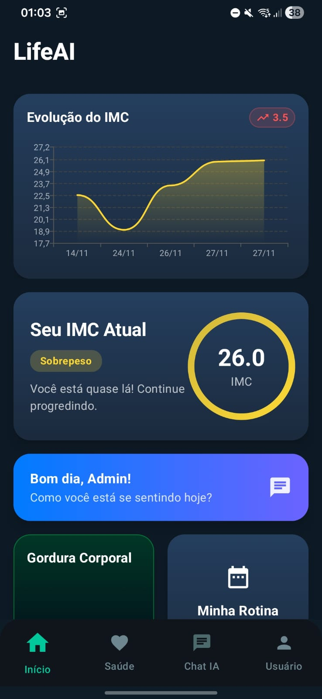
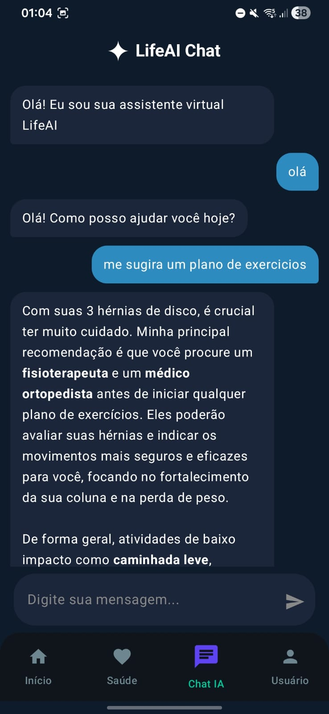

# LIFEAI - Monitor de Saúde Inteligente

"O foco central da aplicação é ser interativa e acessível a todos, estimulando autocuidado e saúde física."

    

## Sobre o Projeto

O **LIFEAI** é uma aplicação mobile desenvolvida como projeto acadêmico na **Escola Tecnológica FPFtech**. O objetivo é democratizar o acesso a ferramentas de saúde, auxiliando usuários — desde jovens até idosos — a monitorar seu bem-estar físico.

A aplicação combina uma interface intuitiva com o poder da **Inteligência Artificial (Google Gemini)** para oferecer recomendações personalizadas de rotina e dieta, integrando uma arquitetura robusta de microsserviços e orquestração em nuvem.

O projeto faz parte de uma solução integrada, composta por aplicativo mobile, backend e infraestrutura em nuvem hospedada na AWS (Amazon Web Services), utilizando Kubernetes (K3s) para orquestração e deploy contínuo.

## Funcionalidades Principais

* **Dashboard de Desempenho:** Visualização gráfica de metas cumpridas e evolução do IMC ao longo do tempo.
* **Chat com IA (Gemini):** Assistente virtual integrado para tirar dúvidas sobre saúde e bem-estar.
* **Planejamento de Rotina Inteligente:** Criação de checklists de hábitos saudáveis gerados automaticamente pela IA ou manualmente.
* **Sugestão de Dieta:** Mapeamento de dieta semanal completa baseada no perfil e restrições do usuário.
* **Calculadora e Histórico de IMC:** Monitoramento de peso e altura com histórico salvo em banco de dados.
* **Guia de Exercícios:** Catálogo de atividades físicas com instruções detalhadas.

## Download da Aplicação

Para testar o aplicativo em seu dispositivo Android, faça o download do APK através do link abaixo:

[**Baixar LifeAI.apk (Versão Beta)**](https://drive.google.com/file/d/1t9WSevaY-PyFBCwdtA--iABnuTDcztJY/view?usp=sharing)

## Telas do Aplicativo

| Login & Onboarding | Home & Dashboard | Chat IA |
|:---:|:---:|:---:|
|  |  |  |
| *Perfil base e objetivo* | *Resumo de desempenho* | *Assistente virtual* |

## Arquitetura e Tecnologias

O projeto utiliza uma arquitetura moderna orientada a serviços, hospedada na nuvem.

### Mobile (Android)
* **Linguagem:** Kotlin
* **Interface:** Jetpack Compose (Material Design 3)
* **Arquitetura:** MVVM (Model-View-ViewModel)

### Backend & Dados
* **API:** Python com Framework Django
* **Banco de Dados:** PostgreSQL / MySQL
* **Inteligência Artificial:** Google Gemini API

### Infraestrutura & DevOps
* **Cloud:** AWS EC2
* **Orquestração:** Kubernetes (K3s)
* **Containerização:** Docker
* **Deploy:** Pipeline automatizado na AWS

## Estrutura do Repositório

```text
LifeAI-mobile/
├── android/          # Aplicativo Android (Kotlin + Jetpack Compose)
├── back/             # Backend e APIs (Django)
├── lifeai_k8s/       # Manifestos Kubernetes e configuração de deploy na AWS
└── README.md         # Documentação principal
```

## Autores

Projeto desenvolvido pelos alunos da **Escola Tecnológica FPFtech**:

* **Gustavo Fernandes dos Santos**
* **João Victor Marques Sampaio**
* **Guilherme da Silva Rosa**

**Orientador:** Francisco Sena

---
*Manaus, 2025*
